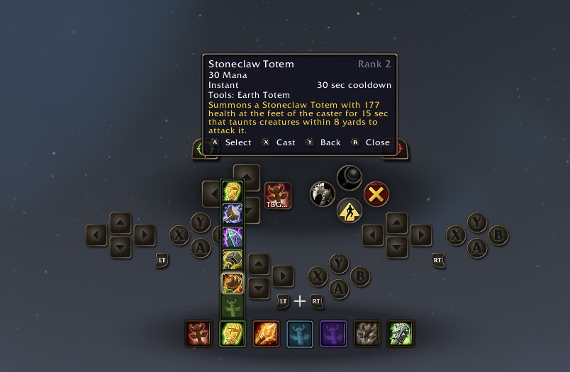
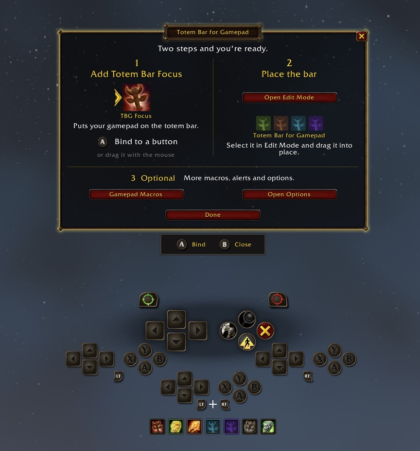
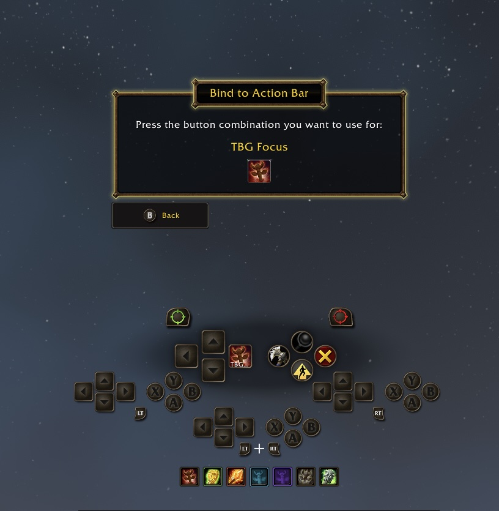
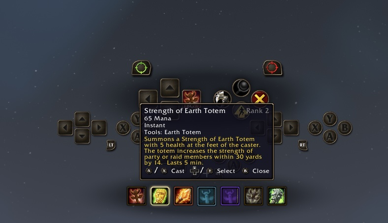
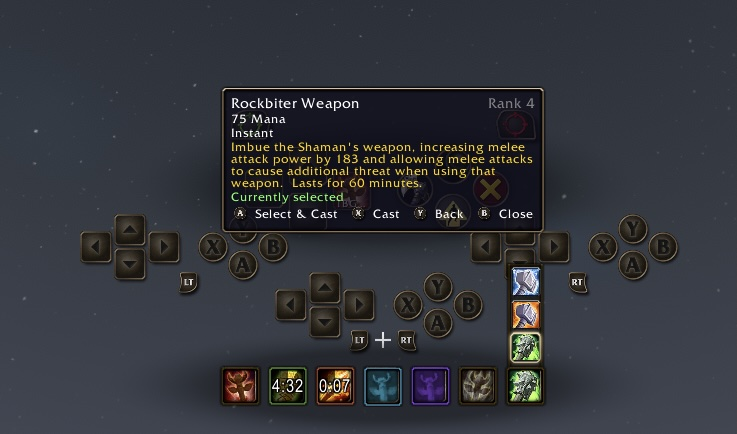
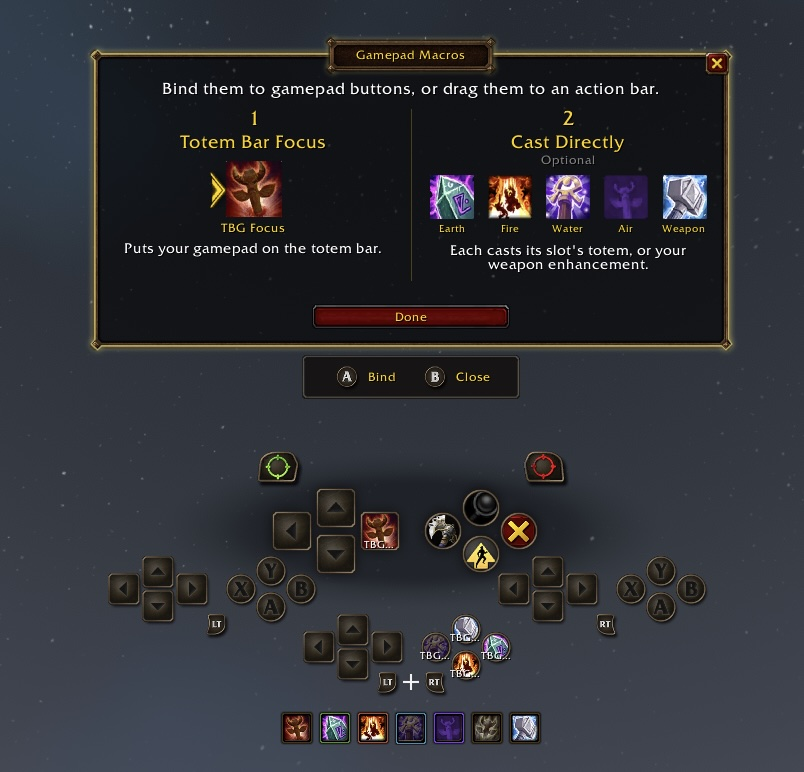
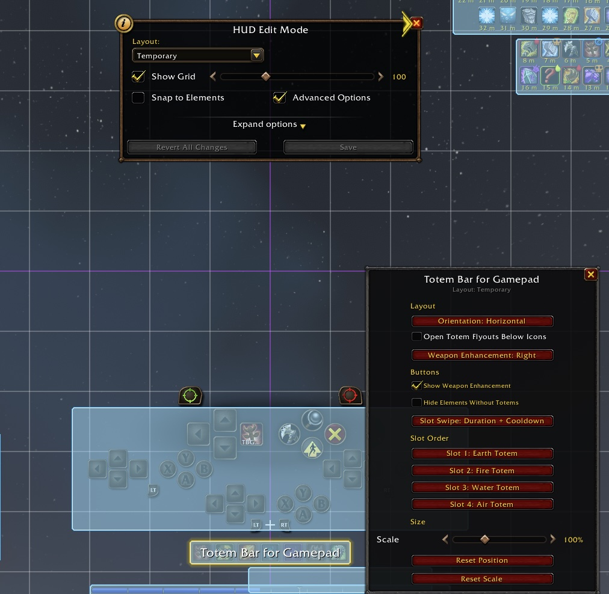
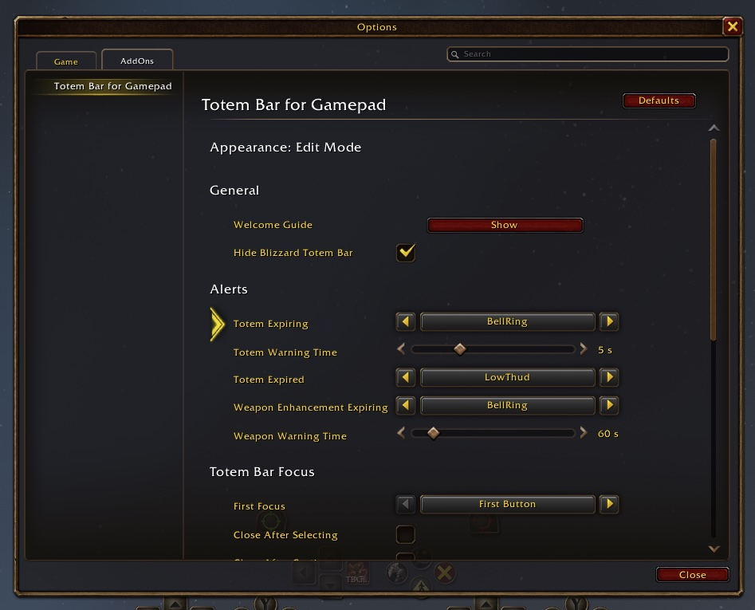
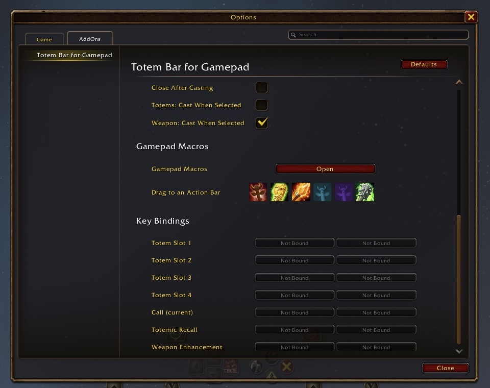

# Totem Bar for Gamepad

A shaman totem bar for World of Warcraft (WoW Forever client) that looks and
behaves like Blizzard's own, built for playing with a gamepad.

- **Totem bar.** Blizzard's look and art, with totem timers and the weapon
  enhancement. It can hide Blizzard's Totem Bar (on by default).
- **Totem Bar Focus.** Puts your gamepad on the totem bar: browse every
  totem with the D-pad and cast or assign with A/X.
- **Edit Mode.** Place the bar from Blizzard's Edit Mode.
- **Gamepad macros.** One-press "Bind to Action Bar" for the addon's macros,
  from the guide or the settings panel.
- **Sound alerts.** Totem expiring, totem gone and weapon enhancement expiring,
  using Blizzard's Cooldown Manager sounds or Text to Speech.
- **First-run guide and settings panel.** Both work fully with a gamepad.
- **Key bindings.** Totem slots, summon, recall and weapon enhancement, under
  Key Bindings → AddOns.

## A quick tour

**Set up in two steps.** The welcome guide adds Totem Bar Focus to a
gamepad button with one press of A.

**Your gamepad on the totem bar.** Totem Bar Focus moves along the bar with
the D-pad. Press A or X to cast. Open a slot to choose another totem.

**Timers and weapon enhancement.** See the time left on each totem. Choose
and cast your weapon enhancement from the same bar.

**Cast directly.** Bind one macro per element, and one for your weapon
enhancement. Each casts that slot's totem with one press.

**Place it in Edit Mode.** Move, scale and arrange the bar with Blizzard's
Edit Mode.

**Options your way.** Sound alerts, Totem Bar Focus behavior, gamepad
macros and key bindings, all in Options → AddOns.

## Development

Building, testing and releasing: see [DEVELOPMENT.md](DEVELOPMENT.md).
