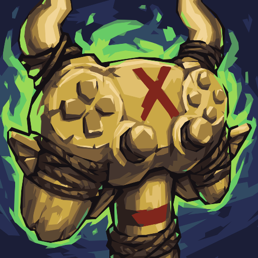

# Totem Bar for Gamepad



A shaman totem bar for World of Warcraft (WoW Forever client) that looks and
behaves like Blizzard's own, built for playing with a gamepad.

- **Totem bar.** Blizzard's look and art, with totem timers and the weapon
  enhancement. It can hide Blizzard's Totem Bar (on by default).
- **Totem Bar Focus.** Puts your gamepad on the totem bar: browse every
  totem with the D-pad and cast or assign with A/X.
- **Edit Mode.** Place the bar from Blizzard's Edit Mode.
- **Gamepad macros.** One-press "Bind to Action Bar" for the addon's macros,
  from the guide or the settings panel.
- **Sound alerts.** Totem expiring, totem gone and weapon enhancement expiring,
  using Blizzard's Cooldown Manager sounds or Text to Speech.
- **First-run guide and settings panel.** Both work fully with a gamepad.
- **Key bindings.** Totem slots, summon, recall and weapon enhancement, under
  Key Bindings → AddOns.

## Repo layout

```
src/        the addon, exactly as it's installed (TOC, Lua, XML, Media/)
  GamepadKit/   embedded, addon-agnostic gamepad library
test/       offline test suite (see test/README.md)
assets/     the full-size logo (the addon ships a small icon in src/Media)
Justfile    test and build recipes
```

## Development

Requirements: [just](https://github.com/casey/just) and Node.js. Install just
with `brew install just`.

```sh
just test     # run the offline test suite against src/
just build    # test, then install src/ into the game's AddOns folder
```

`just build` copies `src/` to
`/Applications/World of Warcraft/_forever_/Interface/AddOns/TotemBarForGamepad`,
mirroring it so removed files are removed there too. If any test fails, nothing
is copied. After a build, `/reload` in game. Saved settings are kept: they live
in the game's `WTF` folder, not the addon folder.

Edit the code in `src/` only. The installed copy is overwritten on every build.

`just test path/to/addon` tests another copy, such as the installed one.

## Testing

The tests run the addon's real Lua outside the game. They load it into
fengari, a Lua VM written in JS, on top of WoW API stubs and a small
secure-environment simulator. They catch syntax errors, broken secure
snippets, leaked globals, load errors and regressions in the gamepad logic.
Taint, art, layout and sound still need checking in game. See
[test/README.md](test/README.md).
